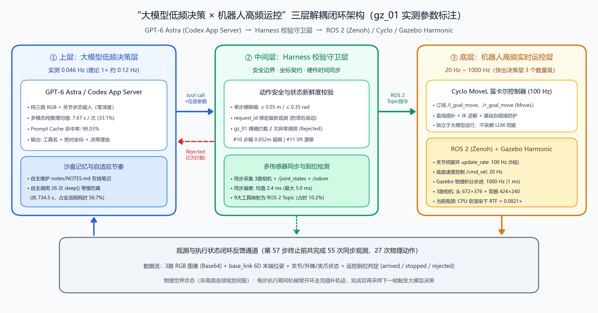
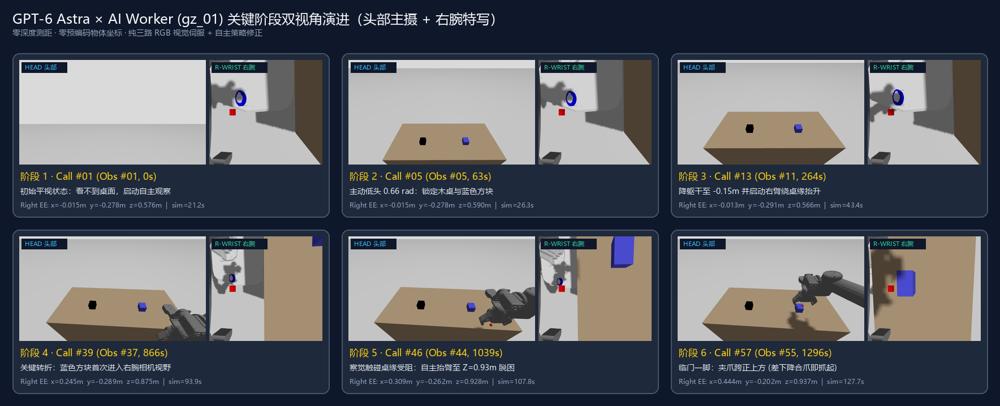
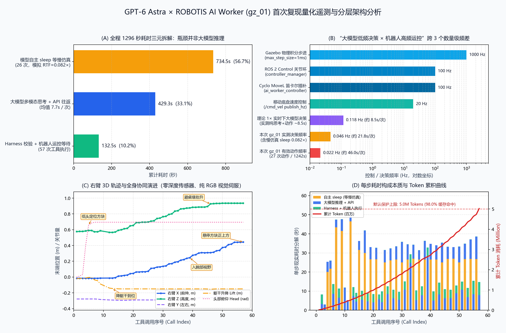

# GPT-6 Astra × ROBOTIS AI Worker — Windows 11 (WSL 2 + Docker) 复现与研究评估

> 基于 ROBOTIS 官方开源项目 [`ROBOTIS-GIT/ai_worker`](https://github.com/ROBOTIS-GIT/ai_worker/tree/feature-codex)（`feature-codex` 分支）及技术文章 [*GPT-6 Astra on the AI Worker*](https://docs.robotis.com/technical-story/ai-worker-codex/) 在 **Windows 11 消费级笔记本** 上的完整工程复现、性能遥测剖析与技术范式评估。

---

## 核心成果总览（`gz_01` 首次端到端跑通）

- **全链路跑通**：在 Windows 11 + WSL 2 (`Ubuntu-24.04`) + Docker Desktop 环境下成功打通 **GPT-6 Astra (Codex App Server) → Harness 校验守卫 → ROS 2 (`rmw_zenoh_cpp`) / Cyclo MoveL → Gazebo Harmonic** 完整具身闭环。
- **零深度纯 RGB 视觉伺服**：在未提供深度测距与物体预设坐标的条件下，模型仅凭三路 RGB 图像与关节状态自主完成 **低头搜寻 → 降躯干 → 绕桌缘抬臂 → 避碰自救 → 像素视差对准**，在第 57 步触及默认 500 万 Token 上限时，右臂夹爪已精准跨停在蓝色方块正上方。
- **关键工程瓶颈定位**：全程现实耗时 **1242.4 s（20 分 42 秒）** 中，大模型单次多模态纯思考+API 延迟均值仅 **7.67 s（占 33.1%）**；真正占去 **56.7%（734.5 s）** 的是模型自主识别到 Gazebo 处于 `0.0821×` 慢仿真后自发调用的 **26 次 `sleep()`**。经容器内 `/root/.gz/rendering/ogre2.log` 核查，确认 Ogre2 回退到了 CPU 软渲染 `llvmpipe (LLVM 20.1.2, 256 bits)`，叠加 `table.sdf` 的 `<real_time_update_rate>100</real_time_update_rate>` 限制了仿真倍速。

---

## 仓库目录结构

| 目录 / 文件 | 内容说明 |
| :--- | :--- |
| [`report/gz_01_evaluation_report.md`](report/gz_01_evaluation_report.md) | 完整 Markdown 研究评估报告（含分层架构、三元耗时拆解、涌现行为与 VLA 对比） |
| [`report/gz_01_evaluation_report.docx`](report/gz_01_evaluation_report.docx) | 排版完整的 Word 评估报告（含页眉页脚、全部图表与 15 步实测附录表） |
| [`media/gz_01_full_replay.mp4`](media/gz_01_full_replay.mp4) | **79.7 秒完整 57 步高清回放视频**（1440×810 H.264，同屏展示三路相机、模型理由与 100 Hz 运控轨迹） |
| [`assets/`](assets/) | 高清三层架构图、六大关键阶段双视角演进图、量化遥测四联图 |
| [`configs/`](configs/) | Windows 11 WSL 2 适配配置（`.wslconfig.example`、`docker-compose.wsl.yml`、`start_sim.sh`） |
| [`scripts/`](scripts/) | 日志遥测分析、架构图绘制、视频合成与 Word 报告自动生成 Python 脚本 |
| [`data/gz_01/`](data/gz_01/) | 脱敏后的 `gz_01` 核心实验档案（`result.json`、`gz01_metrics.json`、`NOTES.md`、`rollout/`、`public/` 55 组三路观测图像与历史） |

---

## 可视化预览

### 1. “大模型低频决策 × 机器人高频运控”三层解耦架构



### 2. 六大关键里程碑双视角演进（头部主摄 + 右腕特写）



### 3. 量化遥测与耗时拆解四联图



---

## Windows 11 快速复现指南

### 1. 基础环境（Windows 宿主机）
- 安装 **WSL 2 (`Ubuntu-24.04`)** 与 **Docker Desktop**（开启 *WSL 2 backend*、*Ubuntu-24.04 WSL Integration* 与 *Enable host networking*）。
- 参考 [`configs/.wslconfig.example`](configs/.wslconfig.example) 配置 `%USERPROFILE%\.wslconfig` 后执行 `wsl --shutdown` 生效（开启 `WSLg`、`mirrored` 网络与 `autoProxy`）。

### 2. 在 WSL 2 中拉取仓库并启动适配容器
```bash
mkdir -p ~/workspace && cd ~/workspace
git clone -b feature-codex https://github.com/ROBOTIS-GIT/ai_worker.git
# 将本仓库 configs/docker-compose.wsl.yml 与 configs/start_sim.sh 放到 ~/workspace/ai_worker/docker/
cd ~/workspace/ai_worker/docker && mkdir -p workspace
docker compose -f docker-compose.wsl.yml up -d
```

### 3. 容器内安装与登录 Codex CLI
```bash
docker exec -it ai_worker bash
mkdir -p /root/.codex_robot && chmod 700 /root/.codex_robot
curl -fsSL https://chatgpt.com/codex/install.sh -o /tmp/codex-install.sh
CODEX_HOME=/root/.codex_robot CODEX_INSTALL_DIR=/usr/local/bin sh /tmp/codex-install.sh
CODEX_HOME=/root/.codex_robot codex login
```

### 4. 启动仿真与下达自然语言任务
```bash
# 容器内一键启动 Zenoh + Gazebo (table 场景) + Cyclo MoveL
/root/ros2_ws/src/ai_worker/docker/start_sim.sh table

# 提交自然语言抓取任务
source /opt/ros/jazzy/setup.bash && source /root/ros2_ws/install/setup.bash
export RMW_IMPLEMENTATION=rmw_zenoh_cpp ROS_DOMAIN_ID=30
cd /root/ros2_ws/src/ai_worker/ffw_codex
python3 run_codex_gazebo.py --task "pick up the blue block" --run-id gz_01
```

---

## 致谢与版权说明
- 上游机器人仿真与 Harness 接口源码归属于 [`ROBOTIS-GIT/ai_worker`](https://github.com/ROBOTIS-GIT/ai_worker/tree/feature-codex)（Apache-2.0 License）。
- 本仓库仅归档 Windows 11 适配配置、量化遥测分析脚本、评估报告及 `gz_01` 复现实验轨迹数据（不含任何账号凭证或敏感认证文件）。
