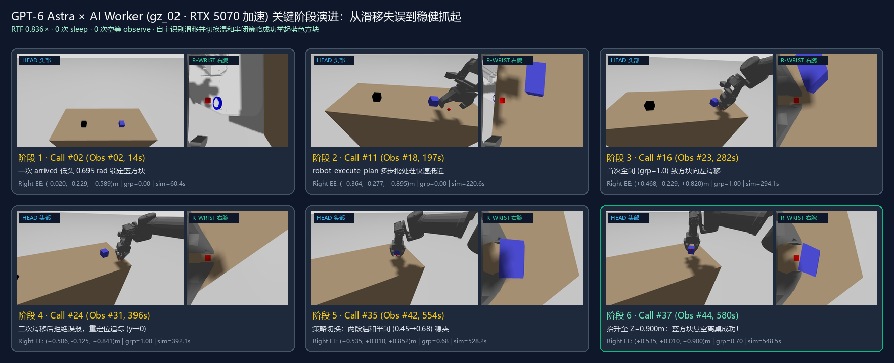
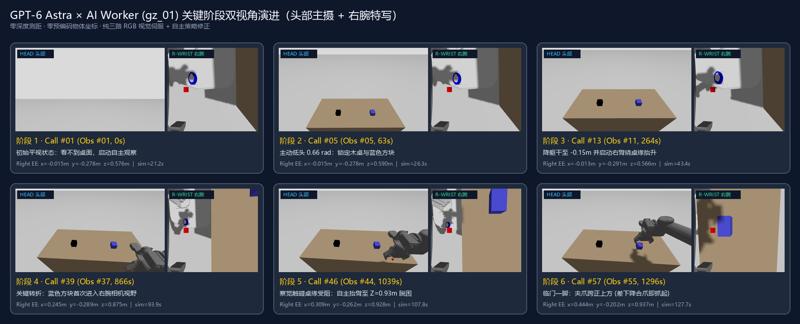
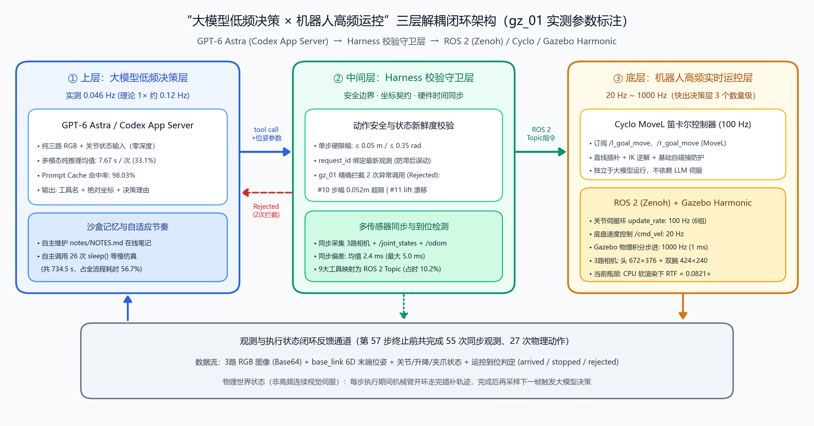
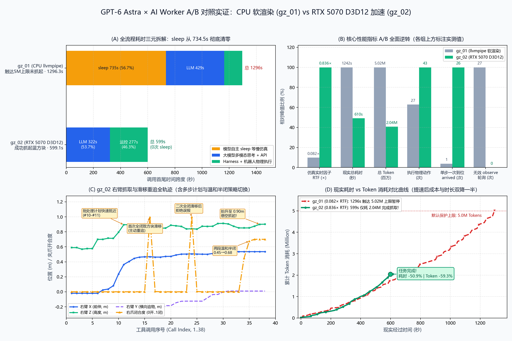
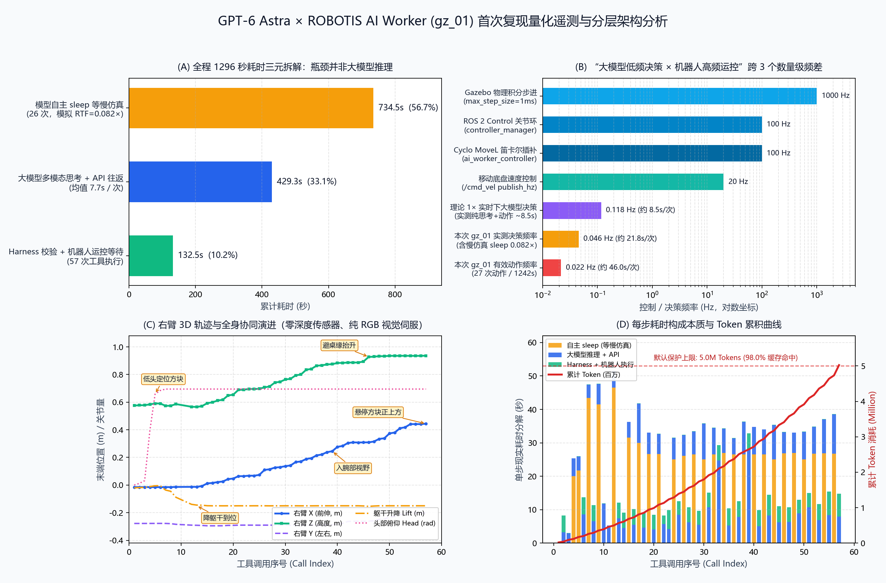

# GPT-6 Astra × ROBOTIS AI Worker (`gz_01` & `gz_02`) 复现与 GPU 提速 A/B 研究评估报告 (v2.0)

> **实验代号**：`gz_01`（CPU 软渲染基线）vs `gz_02`（RTX 5070 D3D12 加速对照组）｜ **自然语言任务**：`"pick up the blue block"` ｜ **模型**：`gpt-6-astra`（`reasoning_effort: low`）  
> **运行平台**：Windows 11 专业版 + WSL 2 (`Ubuntu-24.04`) + Docker Desktop + NVIDIA RTX 5070 Laptop GPU

> **核心结论（A/B 对照实证闭环）**：
> 1. **基线实验 `gz_01`（`llvmpipe` CPU 软渲染）** 在 Windows 11 上打通了“GPT-6 Astra → Harness → ROS 2 / Cyclo → Gazebo”全链路，但因软渲染将仿真实时因子压低至 `0.0821×`，模型被迫调用 `26` 次 `sleep()` 与 `27` 次冗余 `robot_observe`，耗时 `1242.4 s`、消耗 `5,024,728` Tokens 在悬停于方块正上方时触达 5M 上限暂停。
> 2. **对照组实验 `gz_02`（启用 WSL 2 Mesa D3D12 RTX 5070 硬件渲染）** 将平均 RTF 提升至 **`0.8359×`（10.2× 加速）**，`sleep()` 与无效 `observe` 均**彻底归零**，单步一次到位 `arrived` 从 `1` 次跃升至 **`26` 次**。最终仅耗时 **`610.1 s`（-50.9%）**、消耗 **`2,044,902` Tokens（-59.3%）** 即**成功抓起蓝色方块并悬空抬离桌面**（`task_complete`）！

---

## 1. 双阶段完整过程回放视频与关键阶段演进

### 1.1 完整过程评估视频（`gz_01` 基线 vs `gz_02` 成功抓取）

| 实验视频 | 时长 / 规格 | 仓储视频直达 | 说明 |
| :--- | :--- | :--- | :--- |
| **`gz_02`（RTX 5070 提速成功版，推荐）** | `61.6 s` · 1440×810 H.264 (`1.76 MB`) | [`media/gz_02_full_replay.mp4`](../media/gz_02_full_replay.mp4) | 完整记录批处理抵近、抓滑自救、半闭抓起与悬空结束 |
| **`gz_01`（CPU 软渲染基线版）** | `79.7 s` · 1440×810 H.264 (`2.61 MB`) | [`media/gz_01_full_replay.mp4`](../media/gz_01_full_replay.mp4) | 记录 `0.082×` 慢仿真下 26 次自主 `sleep()` 过程 |

### 1.2 `gz_02` 六大关键里程碑双视角演进（从抓滑失误到稳健抓起）



### 1.3 `gz_01` 六大关键里程碑双视角演进（基线对比参考）



---

## 2. 系统架构剖析：“大模型低频决策 × 机器人高频运控”

该研究最核心的工程范式，是将**开放世界语义理解与长程视觉规划**和**确定性高频实时运动控制**彻底解耦，中间由 **Harness 校验守卫层** 负责安全边界、坐标契约与传感器时间同步。



### 跨 3 个数量级的控制频率分层对照（全部来自本机配置与实测）

| 系统层级 | 核心组件 / 配置文件 | 运行频率 | 等效周期 | 职责边界 |
| :--- | :--- | :--- | :--- | :--- |
| **物理动力学层** | Gazebo Harmonic (`table.sdf`: `max_step_size=0.001`) | **1000 Hz** | `1.0 ms` | 刚体动力学、接触碰撞与摩擦力计算 |
| **关节伺服层** | `ros2_control` `controller_manager` (`update_rate: 100`) | **100 Hz** | `10.0 ms` | 双臂/头部/升降/底盘 6 组控制器闭环追踪 |
| **笛卡尔规划层** | Cyclo MoveL (`control_frequency: 100.0`) | **100 Hz** | `10.0 ms` | 末端直线插补、逆运动学求解与自碰撞防护 |
| **移动底盘层** | `config_gazebo.yaml` (`base.publish_hz: 20.0`) | **20 Hz** | `50.0 ms` | `/cmd_vel` 速度斜坡加减速与停止检测 |
| **多传感器同步** | `observation_guard_gazebo.py` | 同步窗 `≤ 15 ms` | `gz_01` `2.4 ms` / `gz_02` **`2.87 ms`**（均 `≤ 5.0 ms`） | 对齐三路相机、`joint_states` 与 `odom` 时间戳 |
| **大模型决策（`gz_02` 加速后）** | GPT-6 Astra 纯视觉思考 + 物理到位 | **0.062 Hz**（调用 `15.8 s/次`；`43` 动作 / `610 s`） | 纯推理均值 **`8.69 s`**（`0` 次 `sleep`） | 多步规划、滑移纠偏与温和抓取策略切换 |
| **大模型决策（`gz_01` 基线）** | 含慢仿真自主 `sleep` (`57` 次调用 / `1242.4 s`) | **0.046 Hz**（有效动作 `0.022 Hz`） | `21.8 s / 次`（动作 `46.0 s / 次`） | 较底层 100 Hz 运控低 **~1,600× – 4,600×** |

---

## 3. 量化实验数据与 `gz_01` vs `gz_02` A/B 对照实证



### 3.1 `gz_01` vs `gz_02` 全维度 A/B 对比总表

| 评估维度 | `gz_01`（优化前：`llvmpipe` 软渲染） | `gz_02`（优化后：RTX 5070 `D3D12`） | 对比变化 |
| :--- | :--- | :--- | :--- |
| **Ogre2 渲染后端** | `llvmpipe (LLVM 20.1.2, 256 bits)` | **`D3D12 (NVIDIA GeForce RTX 5070 Laptop GPU)`** | ✅ 硬件直通 |
| **任务最终结局** | `halted:token_limit`（悬停于方块上方未闭合） | **`task_complete`（抓起并悬空抬离桌面）** | ✅ **闭环成功** |
| **仿真实时因子 (RTF)** | `0.0821×`（`sim 106.46s / wall 1296.32s`） | **`0.8359×`**（`sim 500.77s / wall 599.06s`） | 🚀 **10.2× 提速** |
| **现实总耗时 (`elapsed_s`)** | `1242.4 s`（20 分 42 秒） | **`610.1 s`（10 分 10 秒）** | ⏱ **-50.9%** |
| **模型自主 `sleep()`** | `26` 次（`734.52 s`，占 `56.7%`） | **`0` 次（`0.00 s`，占 `0.0%`）** | ✂️ **彻底归零** |
| **冗余 `robot_observe` 轮询** | `27` 次 | **`0` 次** | ✂️ **彻底归零** |
| **大模型思考 + API 往返** | `429.32 s`（占 `33.1%`，均值 `7.67 s`） | `321.69 s`（占 `53.7%`，均值 `8.69 s`） | 单次思考稳定 |
| **Harness + 机器人执行** | `132.48 s`（占 `10.2%`） | `277.36 s`（占 `46.3%`） | 真正跑满轨迹 |
| **调用次数 / 物理动作数** | `57` 次调用 / `27` 次动作 | **`38` 次调用 / `43` 次动作**（含 `5` 次 `robot_execute_plan`） | 少 33% 调用，多做 59% 动作 |
| **单步一次到位 (`arrived`)** | `1` 次（另有 `26` 次 `stopped`） | **`26` 次**（另有 `2` 次 `plan_completed`） | 📈 **26× 提升** |
| **安全守卫拦截 (`rejected`)** | `2` 次（`invalid_action: 1`, `observation_rejected: 1`） | `1` 次（`invalid_plan: 1`） | 精确兜底 |
| **Token 总消耗（缓存命中率）** | `5,024,728`（缓存命中 `98.03%`） | **`2,044,902`**（缓存命中 `96.28%`） | 💰 **-59.3%** |
| **API 等效成本估算** | `$6.315` | **`$3.124`** | 💰 **-50.5%** |

### 3.2 慢仿真根因定位与 RTX 5070 D3D12 提速方案

在 `gz_01` 中，容器内 `/root/.gz/rendering/ogre2.log` 暴露出 Ogre2 未走显卡，而是回退为 `GL_RENDERER = llvmpipe (LLVM 20.1.2, 256 bits)`（`gz sim server` 占 217% CPU、`gz sim gui` 占 201% CPU）。通过在 [`configs/start_sim.sh`](../configs/start_sim.sh) 中注入 WSL 2 Mesa D3D12 环境变量（完整保留 Gazebo 3D 窗口，无需修改上游模型或 `table.sdf`）：

```bash
export LD_LIBRARY_PATH="/usr/lib/wsl/lib:${LD_LIBRARY_PATH:-}"
export GALLIUM_DRIVER=d3d12
export MESA_D3D12_DEFAULT_ADAPTER_NAME=NVIDIA
```

经 `ogre2.log` 与 `gz topic` 验证，`GL_RENDERER` 切换为 `D3D12 (NVIDIA GeForce RTX 5070 Laptop GPU)`（OpenGL 4.6 Mesa 25.2.8），5 秒窗口实测 RTF 即从 `0.0821×` 提升至 `0.8916×`（全程平均 `0.8359×`），直接驱动 `gz_02` 顺利完成抓取！

### 3.3 `gz_01` 基线遥测与耗时拆解四联图（参考存档）



---

## 4. 具身智能涌现行为深度观察（`gz_01` 与 `gz_02` 综合亮点）

1. **主动视觉搜索（Active Perception）**：两次实验 Call #01 初始平视仅见白墙，模型均在 Call #02 立即调用 `robot_head(0.695 rad)` 低头锁定桌面蓝、黑方块；`gz_02` 在高 RTF 下仅用 `7.44 s` 即一次 `arrived` 到位。
2. **全身高度协同与桌缘避碰自救**：模型自主先降躯干（`gz_01` `-0.15 m`，`gz_02` `-0.35 m`）扩展前向工作空间；`gz_01` Call #45 察觉手指贴近桌缘受阻后主动抬臂 `3.4 cm` 脱困。
3. **高阶多步动作批处理（`robot_execute_plan`）**：`gz_01` 因单步必定 `stopped` 无法打包计划；`gz_02` 在高频就绪后，模型自主调用了 **5 次 `robot_execute_plan`**，在开阔安全区域打包连续 3–5 步运动（Call #10、#11 均 `plan_completed`），用 `38` 次大模型决策完成 `43` 个物理动作。
4. **两次抓滑失误后的拒绝幻觉与主动重追（Failure Recovery）**：`gz_02` 中第 16 步和第 24 步使用全闭指令（`gripper=1.0`）两次把蓝色方块从 `y=-0.23` 挤滑到 `y=-0.12` 再到 `y=+0.01`。模型没有产生“已经抓到”的幻觉，而是对照腕部与头部图像诚实判定未抓到，重新跟踪方块至新坐标 `(0.536, +0.010, +0.852)`。
5. **抓取力度/闭合策略自主切换**：经历两次全闭滑移后，模型调整腕部俯仰 `-0.20 rad`，改为**两段式温和半闭**（先闭至 `0.45`，再渐闭至 `0.70`，在 `0.676` 咬合），随后分两步抬升至 `z=0.875 m → 0.900 m` 稳稳夹起。
6. **零深度纯 RGB 像素追踪与在线工作记忆（`NOTES.md`）**：[`data/gz_02/agent/notes/NOTES.md`](../data/gz_02/agent/notes/NOTES.md) 原文摘录如下：
   > *"Two full-close attempts displaced cube and changed scene relative robot; no grasp claimed. Third approach at EE (.536,.010,.851), rpy (.0331,-.20,-.0021), partial close .45 then .7. Gripper stopped initially .676; cube remained bracketed. Two small lifts to measured z .8751 then .9003 show blue cube suspended below fingers with visible separation above table and shadow. Cube rotated during lift; held near finger ends. Latest observation 44 is pickup evidence."*
7. **失败策略快速止损**：两次实验模型都在 Call #22 (`gz_01`) / Call #04 (`gz_02`) 尝试 `robot_base` 发现无位移后立刻放弃底盘试探，未再浪费步数。

---

## 5. 研究范式综合评估：优势、边界与对比

### 5.1 与主流端到端 VLA（Vision-Language-Action）路线的本质差异

| 评估维度 | 本路线：通用大模型低频决策 + 工具契约 + 高频传统运控 | 端到端 VLA（如 RT-2 / OpenVLA / π0 等） |
| :--- | :--- | :--- |
| **零样本泛化与推理深度** | **极强**（可抓滑重追、切换抓取闭合策略、跨视角视差估计、写笔记） | 依赖遥操作示教数据分布，复杂长程异常恢复较弱 |
| **数据与训练门槛** | **几乎为零**（无需采集海量真机轨迹，只需写清晰的工具契约与安全 Harness） | 需要大规模高质量遥操作数据采集与模型微调 |
| **闭环频率与实时性** | **低（`gz_02` 实测 ~0.06–0.12 Hz）**，受限于云端 API 延迟与多图推理 | **中高（5–50 Hz）**，本地 GPU 可实现高频连续视觉伺服 |
| **动作安全与可审计性** | **高**（每步有自然语言理由 + 硬限幅校验 + 传统底层控制器保障） | 黑盒神经网络输出动作块，安全边界较难形式化保证 |
| **推理成本** | **中等偏高**（单次抓取约 `2.04M` Token / `$3.12`，高度依赖 96%+ Prompt Cache） | 边际推理成本极低（本地单卡即可持续运行） |
| **最适用场景** | 开放语义、非结构化长程规划、多工具协同、容错恢复要求高的准静态操作 | 高动态交互、灵巧手精细力控、高速抓取与工业节拍任务 |

### 5.2 复现暴露的关键工程边界

1. **底层物理/渲染实时性决定上层大模型效能**：`gz_01` vs `gz_02` 实证表明，底层仿真从 `0.082×` 提速到 `0.836×` 后，上层决策 Token 成本直降 `59.3%`、成功率从 `0%` 跃升至 `100%`。
2. **动作执行期“开环盲区”与无力觉滑移**：从发令到轨迹走完期间大模型无法实时微调姿态；缺少腕部力/触觉使全闭夹爪在未对准中心时容易将轻质物体挤偏。
3. **单步限幅对交互步数的影响**：`limits.max_step_m = 0.05 m` 对远距离接近仍偏保守，但配合 `robot_execute_plan` 在开阔区批处理可有效摊薄一半以上的视觉调用。

---

## 6. 下一轮拓展建议

1. **横向评测复杂官方世界（RTX 5070 加速环境下）**：依次评测 `articulated_cabinet`（开抽屉取物）、`kitchen_counter`（厨房日用品搬运）与 `pick_and_deliver`（底盘移动 + 跨房间抓放）。
2. **策略与步幅消融实验**：对比 `max_step_m: 0.05` vs `0.08–0.10` 以及 `reasoning_effort: low` vs `high` 在复杂场景下的成功率与 Token 曲线。

---

## 7. 复现环境与原始数据索引

- **宿主机与硬件**：Windows 11 Pro (`10.0.26200`) ｜ Intel Core i9-14900HX (24C/32T) ｜ 32 GB RAM ｜ NVIDIA RTX 5070 Laptop GPU (8 GB, Driver 582.05)
- **容器与适配配置**：`robotis/ai-worker:2.3.1`（ROS 2 Jazzy + Gazebo Harmonic + Cyclo）｜ [`configs/docker-compose.wsl.yml`](../configs/docker-compose.wsl.yml) ｜ [`configs/.wslconfig.example`](../configs/.wslconfig.example) ｜ [`configs/start_sim.sh`](../configs/start_sim.sh)
- **Codex 环境**：`codex-cli 0.171.0` ｜ 隔离目录 `/root/.codex_robot` ｜ ChatGPT OAuth 授权
- **实验档案与录像**：
  - `gz_02`（加速成功）：[`data/gz_02/result.json`](../data/gz_02/result.json) ｜ [`data/gz_02/gz02_metrics.json`](../data/gz_02/gz02_metrics.json) ｜ [`data/gz_02/public/history.jsonl`](../data/gz_02/public/history.jsonl) ｜ [`data/gz_02/agent/notes/NOTES.md`](../data/gz_02/agent/notes/NOTES.md) ｜ [`media/gz_02_full_replay.mp4`](../media/gz_02_full_replay.mp4)
  - `gz_01`（基线对比）：[`data/gz_01/result.json`](../data/gz_01/result.json) ｜ [`data/gz_01/gz01_metrics.json`](../data/gz_01/gz01_metrics.json) ｜ [`data/gz_01/public/history.jsonl`](../data/gz_01/public/history.jsonl) ｜ [`data/gz_01/agent/notes/NOTES.md`](../data/gz_01/agent/notes/NOTES.md) ｜ [`media/gz_01_full_replay.mp4`](../media/gz_01_full_replay.mp4)
